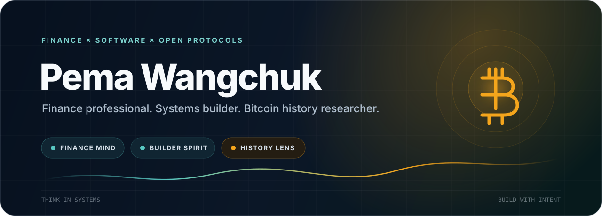
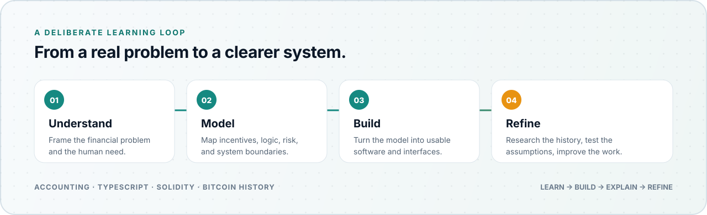

 

### Finance discipline · Software craft · Decentralized systems

I study how sound financial thinking and thoughtful software can make complex systems more useful, transparent, and durable.

 

<a href="https://github.com/pemawangchuk2023?tab=repositories"><strong>Explore my work →</strong></a>
&nbsp;&nbsp;·&nbsp;&nbsp;
<a href="https://linkedin.com/in/pema-wangchuk-5561aa224"><strong>Connect on LinkedIn ↗</strong></a>

 

## The short version

<table>
  <tr>
    <td width="33%" valign="top">
      <h3>01 · Finance</h3>
      
My professional foundation. It shapes how I think about risk, incentives, accountability, and long-term value.

    </td>
    <td width="33%" valign="top">
      <h3>02 · Engineering</h3>
      
My builder's toolkit. I learn by turning ideas into clear interfaces, dependable logic, and working software.

    </td>
    <td width="34%" valign="top">
      <h3>03 · Bitcoin</h3>
      
My research lens. I follow its history, cypherpunk roots, and the people and ideas that made it possible.

    </td>
  </tr>
</table>

> I am most interested in the space where **financial judgment**, **software engineering**, and **open protocols** meet.

 

## How I am building

 

<table>
  <tr>
    <td width="50%" valign="top">
      <h3>Now</h3>
      
Deepening my understanding of accounting, smart contracts, and modern web development through deliberate practice.

      <ul>
        <li>Building robust web experiences</li>
        <li>Studying trust-minimized systems</li>
        <li>Connecting technical choices to financial outcomes</li>
      </ul>
    </td>
    <td width="50%" valign="top">
      <h3>North star</h3>
      
Create practical products at the intersection of finance and decentralized technology—without losing clarity, usability, or human context.

      
<strong>Learn → build → explain → refine.</strong>

    </td>
  </tr>
</table>

 

## Working toolkit

  
<strong>Web engineering</strong>

   
  TypeScript · JavaScript · React · Next.js · Tailwind CSS · TanStack · Node.js

  
<strong>Protocols & data</strong>

   
  Solidity · Smart contracts · Python · Supabase · MongoDB

  
<strong>Daily tools</strong>

   
  Git · GitHub · VS Code

 

## Principles I bring to the work

| Principle | What it means in practice |
| :--- | :--- |
| **Clarity over noise** | Make the important decision obvious and remove what does not help. |
| **Systems over features** | Understand incentives, dependencies, and failure modes before polishing the surface. |
| **Evidence over hype** | Learn from history, test assumptions, and explain trade-offs honestly. |
| **Progress over posturing** | Ship, reflect, document, and improve with consistency. |

 

## Let's compare notes

If you are exploring finance, Bitcoin history, web engineering, or smart contracts, I would be glad to connect.

<a href="https://linkedin.com/in/pema-wangchuk-5561aa224"><strong>LinkedIn</strong></a>
&nbsp;&nbsp;·&nbsp;&nbsp;
<a href="https://github.com/pemawangchuk2023?tab=repositories"><strong>Repositories</strong></a>
&nbsp;&nbsp;·&nbsp;&nbsp;
<a href="https://github.com/pemawangchuk2023?tab=stars"><strong>Reading list</strong></a>

 
 

Designed to load fast, read clearly, and live entirely on GitHub.

